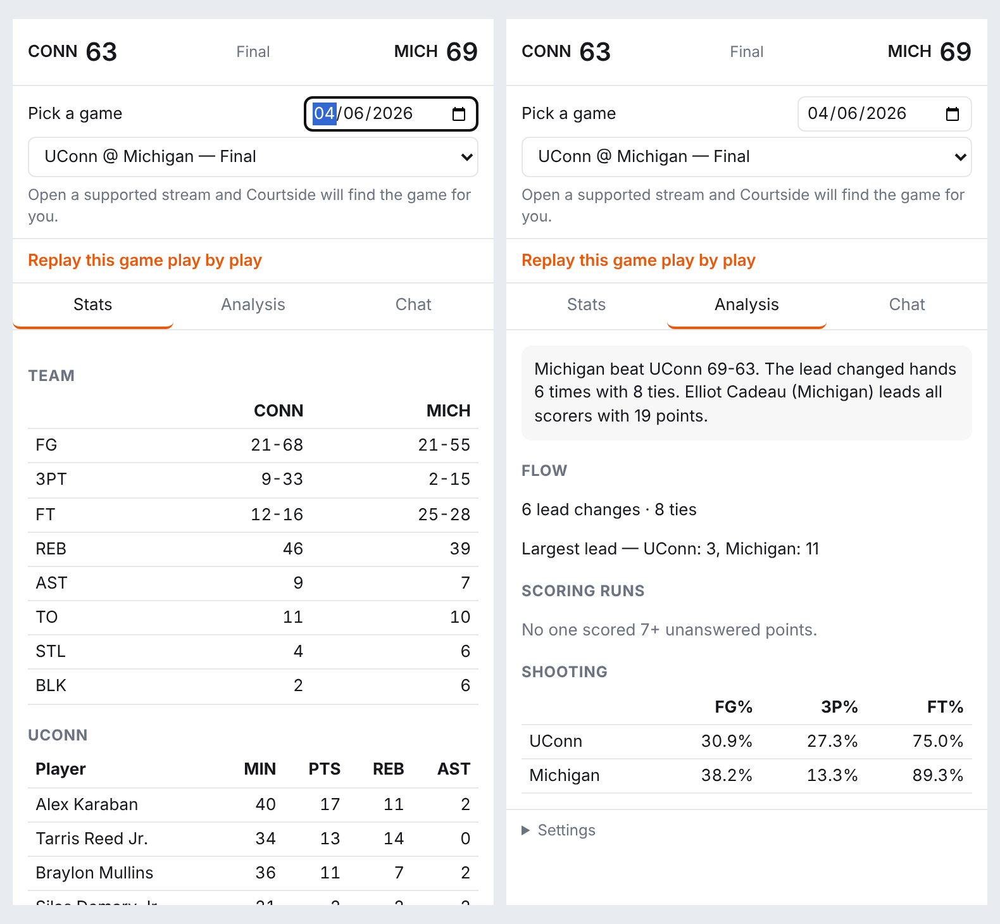

# Courtside 🏀

A Chrome extension for watching college basketball. While you watch a stream, it shows:

- **Live stats:** the scorebug, team and player box scores, and play-by-play
- **Analysis:** an auto-written game summary, lead changes, largest leads, scoring runs, and shooting splits
- **Watch-party chat:** start a room, send friends an invite link, and chat during the game
- **Replay mode:** step through any finished game play by play, as if it were live

More features are coming soon. Very exciting!



Stats come from ESPN's public (unofficial) college basketball endpoints.

## Install the extension

1. Download or clone this repo, then build the extension (Node 18+):
   ```bash
   cd extension && npm install && npm run build
   ```
2. Open `chrome://extensions`, turn on **Developer mode**, click **Load unpacked**, and choose `extension/dist`.
3. Click the Courtside icon in the toolbar to open the side panel.

The extension connects to the hosted backend by default. Its first request after a quiet stretch can take about a
minute while the free server wakes up.

### Watching with friends

Open the **Chat** tab, click **Start a room**, then **Copy invite link** and send it. When a friend with Courtside
opens the link and clicks the Courtside icon, they join your room. They can also type the room code by hand.

## Layout

```
backend/     Python FastAPI service: stats proxy and cache, analysis, replay, WebSocket chat rooms
extension/   Chrome MV3 extension in TypeScript: content scripts, background worker, side panel
render.yaml  Render deploy blueprint for the backend
ROADMAP.md   Plan: v1 by Nov 1, v2 by March Madness 2027
```

## Run the backend locally

**Quick start:** run `bash setup.sh` from this folder. It installs everything, runs the tests, builds the
extension, and prints the next steps. The manual steps (Python 3.11+):

```bash
cd backend
python -m venv .venv && source .venv/bin/activate
pip install -e ".[dev]"
pytest
uvicorn app.main:app --reload       # → http://localhost:8000/docs
```

Then, in the side panel, open **Settings** and click **Use my local backend**.

## How it works

1. `content.ts` runs on supported streaming sites and sends the page title to the background worker.
2. `background.ts` calls `GET /games/match?q=<title>`. The backend matches the title against today's scoreboard
   (handling names like "UConn" / "Connecticut", "St. John's", "Miami (OH)" vs. "Miami", and
   "Michigan State" vs. "Michigan") and saves the game it finds for that tab.
3. The side panel polls `GET /games/{id}` and `/games/{id}/analysis` every 15 seconds.
4. Chat goes through `WS /rooms/{room_id}/ws?name=...`, which reconnects automatically after drops. The protocol is
   documented in `backend/app/rooms.py`.

## API

| Method | Path | Purpose |
|---|---|---|
| GET | `/games?date=YYYYMMDD` | All Division I games on a date |
| GET | `/games/match?q=...` | Find the game a page title refers to |
| GET | `/games/{id}?at=N` | Box score and play-by-play (`at` = replay after N plays) |
| GET | `/games/{id}/analysis?at=N` | Summary, runs, lead changes, shooting |
| POST | `/rooms` | Create a chat room |
| GET | `/join/{id}` | Invite link page |
| WS | `/rooms/{id}/ws?name=` | Join a room |
